# Markloom showcase

A paragraph with *emphasis*, **strong**, ~~strike~~, `inline code`, and a [link](https://example.com/markloom).

Soft break
is still one paragraph.

Hard break follows.  
The next line is a hard break.

See the note[^note] and the logo.

[^note]: A footnote with *emphasis* and `code`.


> A quote with **strong** text
>
> - nested item
> - second nested item

- [ ] open task
- [x] finished task

1. first step
2. second step

## Wide table

| Feature | Github | Compact | Academic | Minimal | Print | Notes | Owner |
| --- | --- | --- | --- | --- | --- | --- | --- |
| Body | 11pt | 9.5pt | serif | 11pt | black | default | style |
| Tables | grid | grid | horizontal | header | grid | borders | sheet |
| Code | theme | inset | theme | border | theme | raw | fonts |
| Quotes | bar | bar | bar | italic | bar | left rule | color |
| Pages | A4 | tight | outline | A4 | numbers | paper | page |
| Diagrams | default | default | neutral | default | default | theme | mermaid |


---

```rust
fn main() {
    let mut pages = 0;
    for section in 0..40 {
        pages += section;
        println!("section {section} pages {pages}");
    }
}
```

## Prose 1

Paragraph 1.0. The preview keeps the same words on the page while the style changes margins, type, and rules. The preview keeps the same words on the page while the style changes margins, type, and rules. The preview keeps the same words on the page while the style changes margins, type, and rules. The preview keeps the same words on the page while the style changes margins, type, and rules. The preview keeps the same words on the page while the style changes margins, type, and rules. The preview keeps the same words on the page while the style changes margins, type, and rules. 

Paragraph 1.1. The preview keeps the same words on the page while the style changes margins, type, and rules. The preview keeps the same words on the page while the style changes margins, type, and rules. The preview keeps the same words on the page while the style changes margins, type, and rules. The preview keeps the same words on the page while the style changes margins, type, and rules. The preview keeps the same words on the page while the style changes margins, type, and rules. The preview keeps the same words on the page while the style changes margins, type, and rules. 

Paragraph 1.2. The preview keeps the same words on the page while the style changes margins, type, and rules. The preview keeps the same words on the page while the style changes margins, type, and rules. The preview keeps the same words on the page while the style changes margins, type, and rules. The preview keeps the same words on the page while the style changes margins, type, and rules. The preview keeps the same words on the page while the style changes margins, type, and rules. The preview keeps the same words on the page while the style changes margins, type, and rules. 

Paragraph 1.3. The preview keeps the same words on the page while the style changes margins, type, and rules. The preview keeps the same words on the page while the style changes margins, type, and rules. The preview keeps the same words on the page while the style changes margins, type, and rules. The preview keeps the same words on the page while the style changes margins, type, and rules. The preview keeps the same words on the page while the style changes margins, type, and rules. The preview keeps the same words on the page while the style changes margins, type, and rules. 

## Prose 2

Paragraph 2.0. The preview keeps the same words on the page while the style changes margins, type, and rules. The preview keeps the same words on the page while the style changes margins, type, and rules. The preview keeps the same words on the page while the style changes margins, type, and rules. The preview keeps the same words on the page while the style changes margins, type, and rules. The preview keeps the same words on the page while the style changes margins, type, and rules. The preview keeps the same words on the page while the style changes margins, type, and rules. 

Paragraph 2.1. The preview keeps the same words on the page while the style changes margins, type, and rules. The preview keeps the same words on the page while the style changes margins, type, and rules. The preview keeps the same words on the page while the style changes margins, type, and rules. The preview keeps the same words on the page while the style changes margins, type, and rules. The preview keeps the same words on the page while the style changes margins, type, and rules. The preview keeps the same words on the page while the style changes margins, type, and rules. 

Paragraph 2.2. The preview keeps the same words on the page while the style changes margins, type, and rules. The preview keeps the same words on the page while the style changes margins, type, and rules. The preview keeps the same words on the page while the style changes margins, type, and rules. The preview keeps the same words on the page while the style changes margins, type, and rules. The preview keeps the same words on the page while the style changes margins, type, and rules. The preview keeps the same words on the page while the style changes margins, type, and rules. 

Paragraph 2.3. The preview keeps the same words on the page while the style changes margins, type, and rules. The preview keeps the same words on the page while the style changes margins, type, and rules. The preview keeps the same words on the page while the style changes margins, type, and rules. The preview keeps the same words on the page while the style changes margins, type, and rules. The preview keeps the same words on the page while the style changes margins, type, and rules. The preview keeps the same words on the page while the style changes margins, type, and rules. 

## Prose 3

Paragraph 3.0. The preview keeps the same words on the page while the style changes margins, type, and rules. The preview keeps the same words on the page while the style changes margins, type, and rules. The preview keeps the same words on the page while the style changes margins, type, and rules. The preview keeps the same words on the page while the style changes margins, type, and rules. The preview keeps the same words on the page while the style changes margins, type, and rules. The preview keeps the same words on the page while the style changes margins, type, and rules. 

Paragraph 3.1. The preview keeps the same words on the page while the style changes margins, type, and rules. The preview keeps the same words on the page while the style changes margins, type, and rules. The preview keeps the same words on the page while the style changes margins, type, and rules. The preview keeps the same words on the page while the style changes margins, type, and rules. The preview keeps the same words on the page while the style changes margins, type, and rules. The preview keeps the same words on the page while the style changes margins, type, and rules. 

Paragraph 3.2. The preview keeps the same words on the page while the style changes margins, type, and rules. The preview keeps the same words on the page while the style changes margins, type, and rules. The preview keeps the same words on the page while the style changes margins, type, and rules. The preview keeps the same words on the page while the style changes margins, type, and rules. The preview keeps the same words on the page while the style changes margins, type, and rules. The preview keeps the same words on the page while the style changes margins, type, and rules. 

Paragraph 3.3. The preview keeps the same words on the page while the style changes margins, type, and rules. The preview keeps the same words on the page while the style changes margins, type, and rules. The preview keeps the same words on the page while the style changes margins, type, and rules. The preview keeps the same words on the page while the style changes margins, type, and rules. The preview keeps the same words on the page while the style changes margins, type, and rules. The preview keeps the same words on the page while the style changes margins, type, and rules. 

## Prose 4

Paragraph 4.0. The preview keeps the same words on the page while the style changes margins, type, and rules. The preview keeps the same words on the page while the style changes margins, type, and rules. The preview keeps the same words on the page while the style changes margins, type, and rules. The preview keeps the same words on the page while the style changes margins, type, and rules. The preview keeps the same words on the page while the style changes margins, type, and rules. The preview keeps the same words on the page while the style changes margins, type, and rules. 

Paragraph 4.1. The preview keeps the same words on the page while the style changes margins, type, and rules. The preview keeps the same words on the page while the style changes margins, type, and rules. The preview keeps the same words on the page while the style changes margins, type, and rules. The preview keeps the same words on the page while the style changes margins, type, and rules. The preview keeps the same words on the page while the style changes margins, type, and rules. The preview keeps the same words on the page while the style changes margins, type, and rules. 

Paragraph 4.2. The preview keeps the same words on the page while the style changes margins, type, and rules. The preview keeps the same words on the page while the style changes margins, type, and rules. The preview keeps the same words on the page while the style changes margins, type, and rules. The preview keeps the same words on the page while the style changes margins, type, and rules. The preview keeps the same words on the page while the style changes margins, type, and rules. The preview keeps the same words on the page while the style changes margins, type, and rules. 

Paragraph 4.3. The preview keeps the same words on the page while the style changes margins, type, and rules. The preview keeps the same words on the page while the style changes margins, type, and rules. The preview keeps the same words on the page while the style changes margins, type, and rules. The preview keeps the same words on the page while the style changes margins, type, and rules. The preview keeps the same words on the page while the style changes margins, type, and rules. The preview keeps the same words on the page while the style changes margins, type, and rules. 


## flowchart

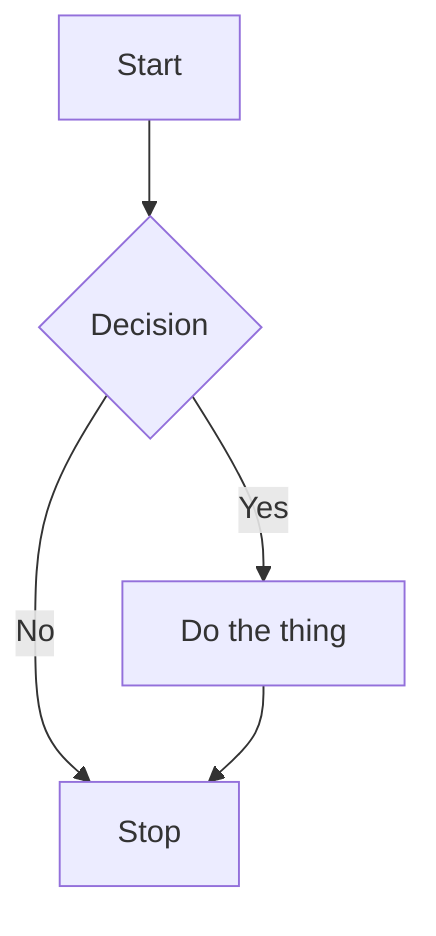

## sequence

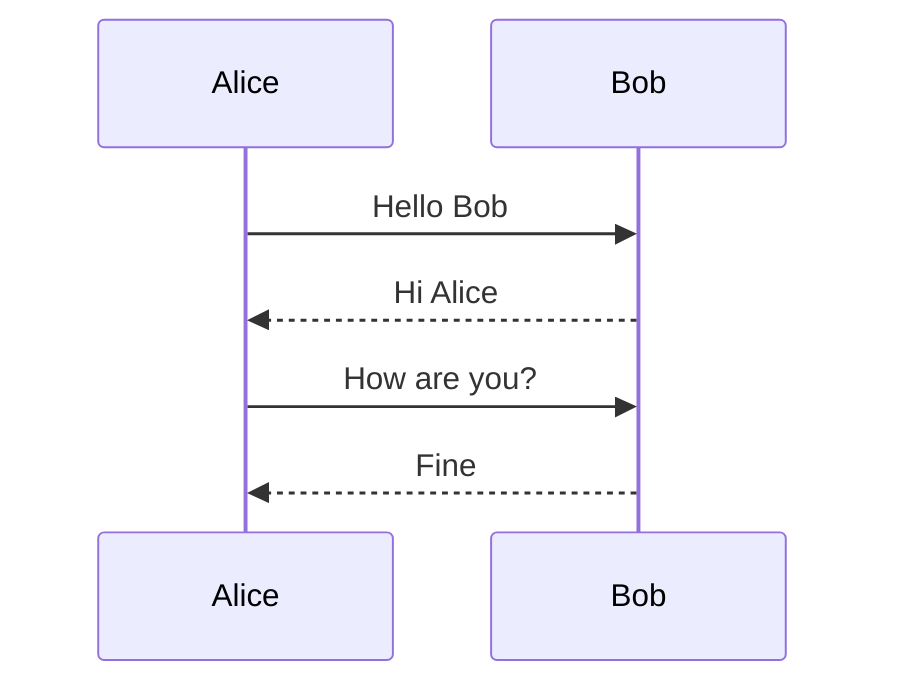

## class

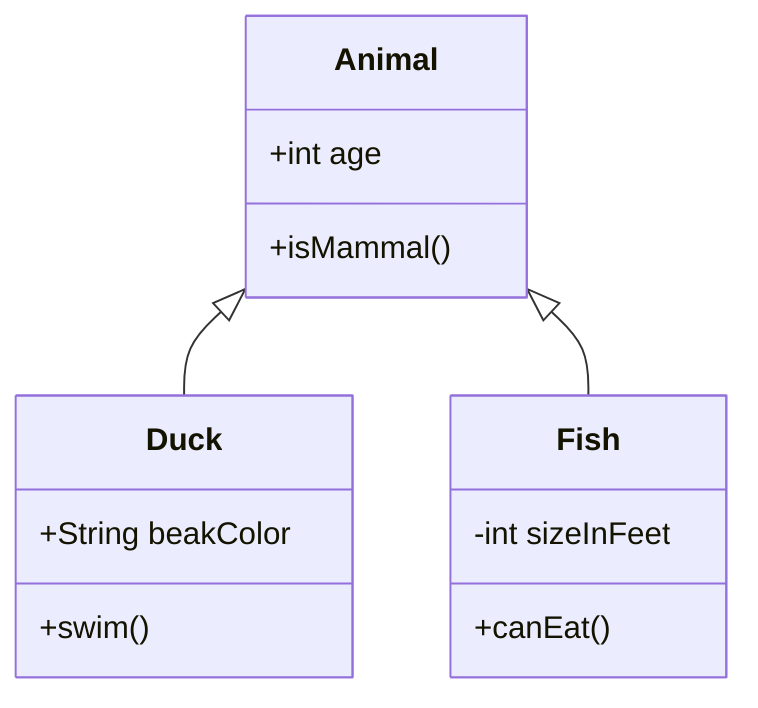

## state

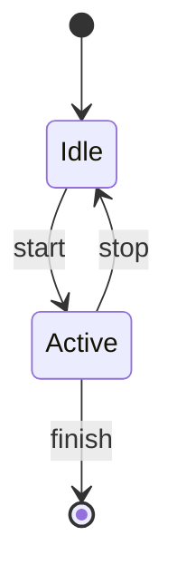

## er

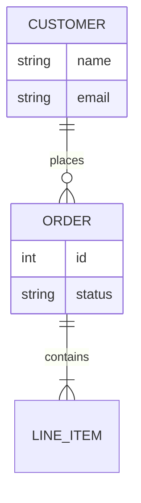

## journey

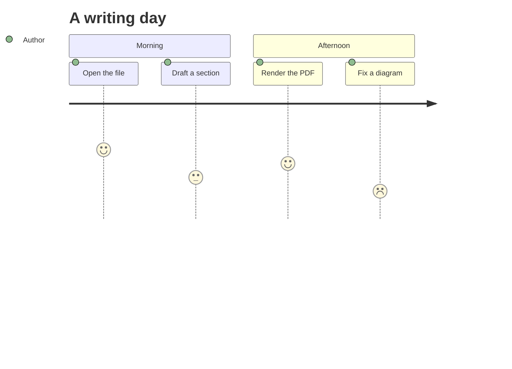

## gantt

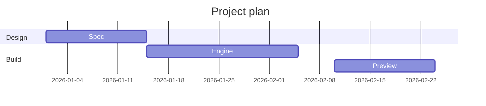

## pie

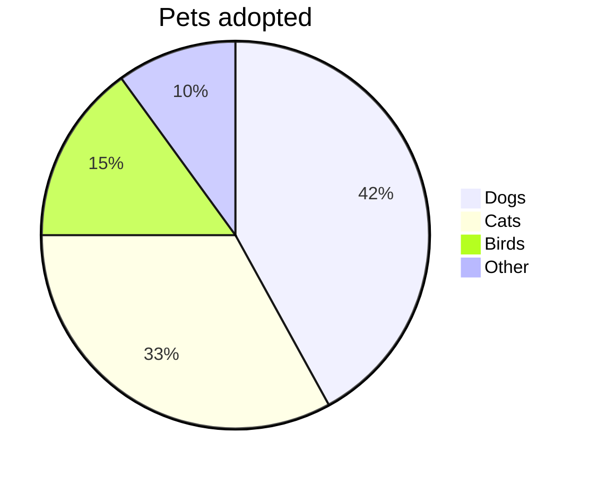

## quadrant

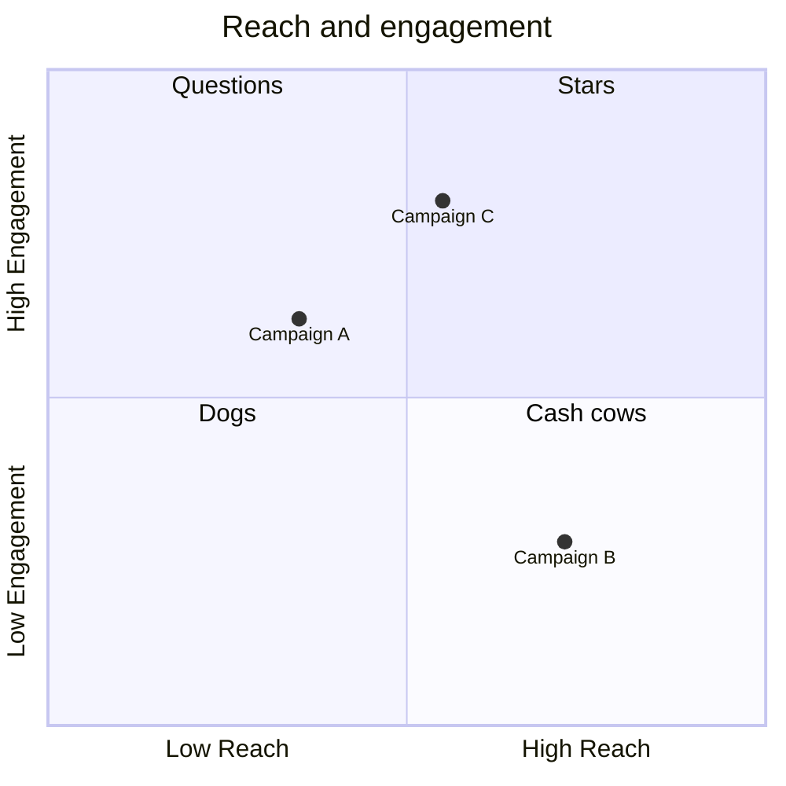

## mindmap

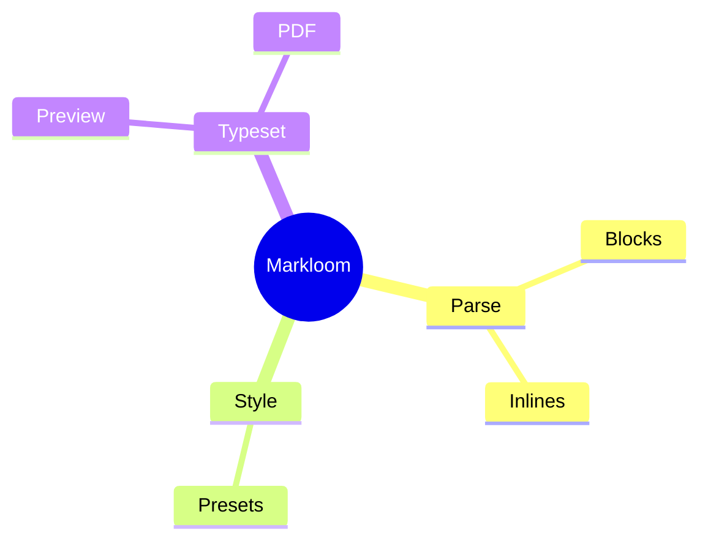

## timeline

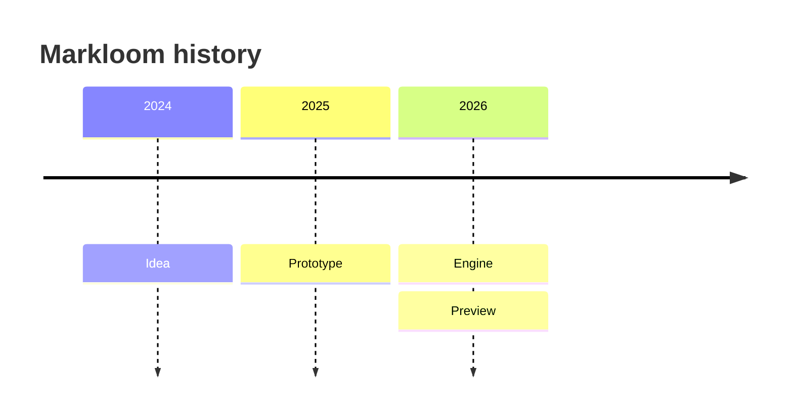

## gitgraph

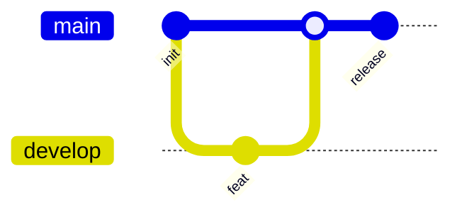

## xychart

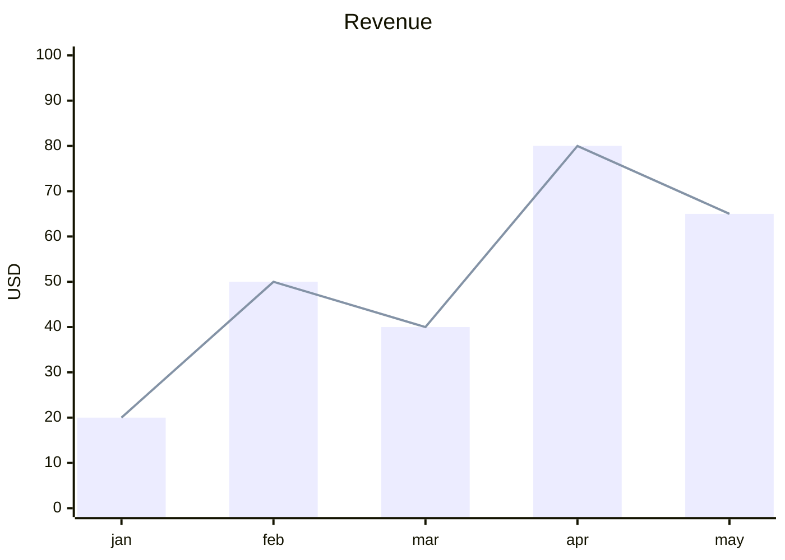

